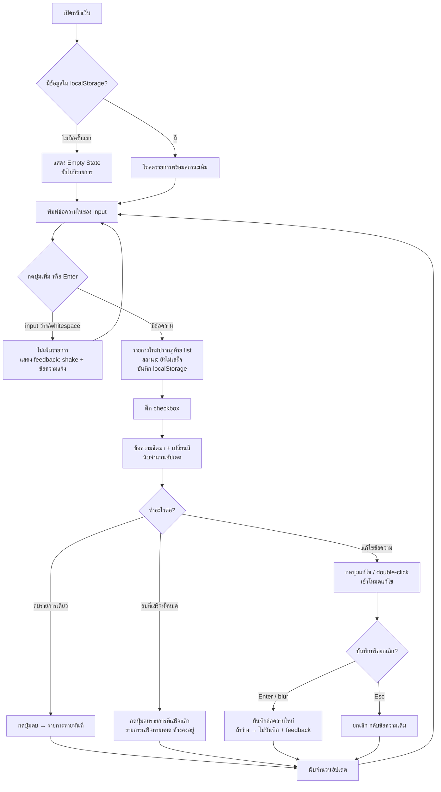

# UX Design — เว็บ Todo List

> อ้างอิงจาก `docs/01-backlog.md` (US-001 ถึง US-007) — จัดทำโดย UI/UX Designer
> ขอบเขต: ออกแบบประสบการณ์ผู้ใช้เท่านั้น ไม่ระบุ tech stack (เป็นหน้าที่ของ architect)

---

## 1. แนวคิดหลัก (Design Concept)

- **Single page app**: ทุกอย่างอยู่ในหน้าจอเดียว ไม่มี navigation ไปหน้าอื่น ผู้ใช้เห็น input, list, สถานะนับ และปุ่มลบทั้งหมดใน viewport เดียว
- **ง่ายที่สุดใน 3 คลิก**: เพิ่ม → ติ๊ก → ลบ ทำได้โดยไม่ต้องเปิดเมนูหรือ modal ใด ๆ
- **Feedback ทันที**: ทุกการกระทำ (เพิ่ม/ติ๊ก/ลบ/แก้ไข) ต้องเห็นผลบนหน้าจอทันที ไม่มี loading state เพราะทำงานฝั่ง client ทั้งหมด
- **ไม่มี filter** (ตาม Confirmed Decision #2 และ Out of Scope ของ backlog) — แสดงรายการทั้งหมดเรียงตามลำดับที่เพิ่ม

---

## 2. User Flow

### 2.1 Flow หลัก: ใช้งานทั่วไป



### 2.2 Flow ย่อย: แก้ไขข้อความ (US-005)

1. ผู้ใช้กดปุ่ม "แก้ไข / Edit" บนรายการ (หรือ double-click ที่ข้อความ)
2. ข้อความเปลี่ยนเป็น input field พร้อมข้อความเดิมอยู่ข้างใน (focus + select อัตโนมัติ)
3. ทางเลือกของผู้ใช้:
   - แก้ข้อความ → กด **Enter** หรือกดปุ่ม "บันทึก / Save" → บันทึก
   - กด **Esc** หรือกดปุ่ม "ยกเลิก / Cancel" → กลับข้อความเดิม
   - แก้เป็นค่าว่าง/whitespace แล้วกด Enter → **ไม่บันทึก** แสดง feedback เดียวกับ US-001 (shake + ข้อความแจ้ง) ยังอยู่ในโหมดแก้ไข
4. จำกัด: แก้ไขได้ **ทีละ 1 รายการ** — ถ้าอยู่ในโหมดแก้ไขรายการหนึ่ง การกดแก้ไขรายการอื่นจะบันทึก/ยกเลิกรายการเดิมก่อน (แนะนำ: บันทึกอัตโนมัติถ้าข้อความไม่ว่าง)

### 2.3 Flow ย่อย: ลบรายการที่เสร็จแล้วทั้งหมด (US-006)

1. ปุ่ม "ลบรายการที่เสร็จแล้ว / Clear completed" อยู่ในแถบสถานะด้านล่าง list
2. เงื่อนไขแสดง: ปุ่ม **enabled** เมื่อมีรายการเสร็จ ≥ 1, **disabled** เมื่อไม่มี (แสดงแต่ disabled เพื่อให้ผู้ใช้รู้ว่าฟีเจอร์นี้มีอยู่)
3. กดแล้ว: รายการที่เสร็จทั้งหมดหายไปทันที รายการที่ยังไม่เสร็จคงอยู่ นับจำนวนอัปเดต
4. ไม่ทำ confirmation dialog เพราะ (a) รายการเสร็จถือว่าใช้งานเสร็จแล้ว ความเสียหายต่ำ (b) ผู้ใช้เป้าหมายต้องการความเร็ว — หากต้องการ undo ให้พิจารณาเป็น enhancement อนาคต (ไม่อยู่ใน backlog)

> **คำถามถึง PM/ผู้ใช้**: US-006 ไม่ได้ระบุว่าต้องมี confirmation หรือไม่ — การออกแบบนี้เลือก "ไม่มี confirmation" ตามเหตุผลข้างต้น หากผู้ใช้ต้องการ แจ้งกลับเพื่อปรับ flow

---

## 3. โครงสร้างหน้าจอ (Single Page)

### 3.1 รายการองค์ประกอบ

| # | องค์ประกอบ | อ้างอิง | รายละเอียด |
|---|---|---|---|
| 1 | หัวเรื่อง (Header) | — | "รายการสิ่งที่ต้องทำ / Todo List" แสดงเป็น heading ระดับ h1 |
| 2 | ช่อง input + ปุ่มเพิ่ม | US-001 | input ข้อความ 1 ช่อง (placeholder สองภาษา) + ปุ่ม "เพิ่ม / Add" อยู่ข้างกันในแถวเดียว |
| 3 | รายการ todo (list) | US-002, US-003, US-005 | แต่ละแถว: checkbox + ข้อความ + ปุ่มแก้ไข + ปุ่มลบ เรียงตามลำดับที่เพิ่ม (ใหม่อยู่ท้ายสุด) |
| 4 | แถบสถานะนับ | US-007 | แสดง "ค้าง: N / Pending" และ "เสร็จแล้ว: M / Done" อัปเดตทันที |
| 5 | ปุ่มลบรายการที่เสร็จแล้วทั้งหมด | US-006 | อยู่แถวเดียวกับแถบสถานะนับ disabled เมื่อไม่มีรายการเสร็จ |
| 6 | Empty state | US-004 | แสดงเมื่อไม่มีรายการเลย (ดูหัวข้อ 5) |
| 7 | พื้นที่ feedback message | US-001, US-005 | ข้อความแจ้งเตือนสั้น ๆ ใต้ช่อง input เช่น "กรุณาพิมพ์สิ่งที่ต้องทำ / Please enter a task" |

### 3.2 Wireframe (Desktop)

```
┌──────────────────────────────────────────────────────┐
│                                                      │
│        รายการสิ่งที่ต้องทำ / Todo List                 │  ← h1 กึ่งกลาง
│                                                      │
│   ┌──────────────────────────────────┐ ┌──────────┐  │
│   │ พิมพ์สิ่งที่ต้องทำ… / Add a task…  │ │ เพิ่ม/Add │  │  ← แถว input + ปุ่ม
│   └──────────────────────────────────┘ └──────────┘  │
│   ⚠ กรุณาพิมพ์สิ่งที่ต้องทำ / Please enter a task      │  ← feedback (แสดงเมื่อมีข้อผิดพลาดเท่านั้น)
│                                                      │
│   ─────────────── รายการทั้งหมด ───────────────────   │
│                                                      │
│   ☐  ซื้อข้าวเย็น                    [✎ แก้ไข] [🗑 ลบ] │  ← ยังไม่เสร็จ
│   ☑  ทำการบ้าน ~~ส่งพรุ่งนี้~~        [✎ แก้ไข] [🗑 ลบ] │  ← เสร็จแล้ว (ขีดฆ่า + สีจาง)
│   ☐  อ่านหนังสือ / Read book         [✎ แก้ไข] [🗑 ลบ] │
│                                                      │
│   ─────────────────────────────────────────────────  │
│   ค้าง: 2 / Pending   เสร็จแล้ว: 1 / Done             │  ← แถบสถานะ
│                        [ลบรายการที่เสร็จแล้ว / Clear]  │
│                                                      │
└──────────────────────────────────────────────────────┘
```

### 3.3 Wireframe (มือถือ < 480px)

```
┌──────────────────────────┐
│ รายการสิ่งที่ต้องทำ        │
│ / Todo List              │
│                          │
│ ┌──────────────────────┐ │
│ │ พิมพ์สิ่งที่ต้องทำ…    │ │
│ └──────────────────────┘ │
│ ┌──────────────────────┐ │
│ │      เพิ่ม / Add      │ │  ← ปุ่มเพิ่มอยู่แถวใหม่ เต็มความกว้าง
│ └──────────────────────┘ │
│                          │
│ ☐ ซื้อข้าวเย็น            │
│            [✎]     [🗑]  │  ← ปุ่มแก้ไข/ลบเป็น icon-only
│ ☑ ~~ทำการบ้าน~~          │
│            [✎]     [🗑]  │
│                          │
│ ค้าง: 1  เสร็จ: 1        │
│ ┌──────────────────────┐ │
│ │ ลบที่เสร็จแล้ว / Clear │ │
│ └──────────────────────┘ │
└──────────────────────────┘
```

---

## 4. สถานะของรายการและหน้าจอ

### 4.1 สถานะรายการแต่ละแถว

| สถานะ | ลักษณะ | อ้างอิง |
|---|---|---|
| ยังไม่เสร็จ (default) | checkbox ว่าง, ข้อความปกติ, ปุ่มแก้ไข/ลบมองเห็นชัด | US-001, US-003 |
| เสร็จแล้ว | checkbox ติ๊กแล้ว, ข้อความ **ขีดฆ่า (line-through)** + สีจางลง, ปุ่มแก้ไข/ลบยังใช้ได้ | US-003 |
| โหมดแก้ไข | ข้อความกลายเป็น input field, ซ่อนปุ่มแก้ไข/ลบชั่วคราว, แสดงปุ่ม "บันทึก / Save" + "ยกเลิก / Cancel" (หรือใช้ Enter/Esc) | US-005 |

### 4.2 สถานะพิเศษของหน้าจอ

| สถานะ | เงื่อนไข | การแสดงผล | อ้างอิง |
|---|---|---|---|
| **Empty state** | ไม่มีรายการใน localStorage (ครั้งแรก) หรือลบจนหมด | ข้อความกลางพื้นที่ list: "ยังไม่มีรายการ — เริ่มพิมพ์ด้านบนได้เลย / No tasks yet — start by adding one above" พร้อม icon/ภาพประกอบเล็ก ๆ ไม่แสดง error | US-004 |
| **Input ว่างกดเพิ่ม** | กดปุ่มเพิ่ม/Enter โดย input ว่างหรือมีแต่ whitespace | ไม่เพิ่มรายการ + (1) ช่อง input **สั่น (shake animation)** (2) แสดงข้อความ "กรุณาพิมพ์สิ่งที่ต้องทำ / Please enter a task" ใต้ช่อง input สีแดง/สีเตือน (3) focus กลับที่ input | US-001 |
| **แก้ไขเป็นค่าว่าง** | บันทึกการแก้ไขโดยข้อความว่าง/whitespace | ไม่บันทึก + shake ที่ input ในแถวนั้น + แสดงข้อความแจ้งเหมือนข้างบน ยังอยู่ในโหมดแก้ไข | US-005 |
| **localStorage เสียหาย** | อ่านข้อมูลจาก localStorage ไม่ได้/parse ล้มเหลว | ไม่ crash — แสดง empty state และทำงานต่อได้ปกติ (แนะนำ: ลบข้อมูลเสียทิ้งแล้วเริ่มใหม่) | US-004 |
| **Loading** | — | **ไม่มี loading state** เพราะทำงานฝั่ง client ทั้งหมด ข้อมูลโหลดจาก localStorage ทันทีเมื่อเปิดหน้า | US-004 |
| **Error** | — | ไม่มี error state จากระบบ (ไม่มี network/backend) มีเพียง validation feedback ตามข้างบน | — |

---

## 5. ข้อกำหนด UI สองภาษา (Hybrid: ไทย + อังกฤษ)

ตาม Product Requirements ของ backlog — ใช้รูปแบบ **"ไทย / English" ในป้ายเดียวกัน** (ไทยมาก่อน, คั่นด้วย `/`), ส่วน placeholder ใช้รูปแบบเดียวกัน:

| องค์ประกอบ | ข้อความที่แสดง |
|---|---|
| หัวเรื่องหน้า | `รายการสิ่งที่ต้องทำ / Todo List` |
| Placeholder ช่อง input | `พิมพ์สิ่งที่ต้องทำ… / Add a task…` |
| ปุ่มเพิ่ม | `เพิ่ม / Add` |
| ปุ่มแก้ไข | `แก้ไข / Edit` (มือถือ: icon ✎ + aria-label สองภาษา) |
| ปุ่มลบ | `ลบ / Delete` (มือถือ: icon 🗑 + aria-label สองภาษา) |
| ปุ่มบันทึก (โหมดแก้ไข) | `บันทึก / Save` |
| ปุ่มยกเลิก (โหมดแก้ไข) | `ยกเลิก / Cancel` |
| นับจำนวน | `ค้าง: 3 / Pending` และ `เสร็จแล้ว: 2 / Done` |
| ปุ่มลบที่เสร็จแล้วทั้งหมด | `ลบรายการที่เสร็จแล้ว / Clear completed` |
| Empty state | `ยังไม่มีรายการ — เริ่มพิมพ์ด้านบนได้เลย / No tasks yet — start by adding one above` |
| ข้อความแจ้ง input ว่าง | `กรุณาพิมพ์สิ่งที่ต้องทำ / Please enter a task` |

**หลักการ:**
- ภาษาไทยเป็นหลัก (มาก่อน, ขนาดตัวอักษรปกติ) ภาษาอังกฤษเป็นรอง (ขนาดเล็กกว่าเล็กน้อยหรือสีจางกว่าใน label ที่มีพื้นที่จำกัด เช่น ปุ่ม)
- ปุ่มที่พื้นที่จำกัดมาก (มือถือ) ใช้ icon + aria-label สองภาษาแทนข้อความเต็ม
- ข้อความของรายการ todo เป็นของผู้ใช้พิมพ์เอง — ระบบไม่บังคับภาษา

---

## 6. Responsive Design

| Breakpoint | Layout |
|---|---|
| Desktop (≥ 768px) | คอนเทนต์จำกัดความกว้างสูงสุด ~600px กึ่งกลางหน้า, input + ปุ่มเพิ่มอยู่แถวเดียวกัน, ปุ่มแก้ไข/ลบแสดงข้อความสองภาษาเต็ม |
| มือถือ (< 768px) | คอนเทนต์เต็มความกว้าง (padding ข้าง ~16px), ปุ่มเพิ่มอยู่แถวใหม่ใต้ input (เต็มความกว้าง), ปุ่มแก้ไข/ลบย่อเป็น icon-only, แถบสถานะนับ + ปุ่ม clear เรียงซ้อนกันได้ |
| ทุกขนาด | แตะ/คลิก target ขนาดขั้นต่ำ **44×44px** (มือถือ), ระยะห่างระหว่างปุ่มในแถวเดียวกัน ≥ 8px กันกดพลาด |

---

## 7. Accessibility (พื้นฐาน)

- **Label**: ช่อง input ต้องมี `<label>` ที่ผูกกับ input (สามารถซ่อนด้วย visually-hidden ได้ แต่ต้องมี) — ห้ามใช้ placeholder เป็น label เดียว
- **ARIA**:
  - list ของ todo ใช้ role="list" / แต่ละแถว role="listitem"
  - checkbox ของแต่ละรายการเป็น input จริง (type="checkbox") พร้อม aria-label เช่น "ทำเครื่องหมายว่าเสร็จแล้ว: ซื้อข้าวเย็น / Mark complete: buy dinner"
  - ข้อความแจ้งเตือน (input ว่าง) ใช้ `aria-live="polite"` เพื่อให้ screen reader อ่านออก
  - ตัวเลขนับจำนวนใช้ `aria-live="polite"` เช่นกัน
  - ปุ่ม disabled ต้องมี `disabled` attribute จริง (screen reader รู้ว่าใช้ไม่ได้)
- **คีย์บอร์ด**:
  - **Enter** ในช่อง input หลัก = เพิ่มรายการ (เท่ากับกดปุ่มเพิ่ม)
  - **Enter** ในโหมดแก้ไข = บันทึก
  - **Esc** ในโหมดแก้ไข = ยกเลิก กลับข้อความเดิม
  - **Tab** เลื่อนผ่านองค์ประกอบได้ครบตามลำดับตรรกะ: input → ปุ่มเพิ่ม → checkbox → ปุ่มแก้ไข → ปุ่มลบ (ของแต่ละแถว) → ปุ่ม clear
  - ปุ่มทุกปุ่มต้องเป็น `<button>` จริง (focus ได้, กด Space/Enter ได้)
- **สี/คอนทราสต์**: สถานะ "เสร็จแล้ว" ต้องไม่พึ่งสีอย่างเดียว — ใช้ขีดฆ่า + checkbox ติ๊กช่วยสื่อความหมาย, คอนทราสต์ข้อความ ≥ 4.5:1
- **Focus visible**: ทุก element ที่ focus ได้ต้องมี focus ring ชัดเจน

---

## 8. แนวทางภาพรวม (Visual Guidelines)

> หมายเหตุ: ส่วนนี้เป็นแนวทางเพื่อการ implement ไม่ได้เลือกเทคโนโลยี

- **สี**: โทนเรียบ ๆ — พื้นหลังขาว/สีอ่อน, สีหลัก 1 สี (แนะนำโทนน้ำเงิน/เขียว) สำหรับปุ่มเพิ่มและ checkbox ที่ติ๊ก, สีเตือน (แดง/ส้ม) เฉพาะปุ่มลบและข้อความ validation, สีเทาสำหรับข้อความที่ "เสร็จแล้ว"
- **ตัวอักษร**: font ที่รองรับไทย+อังกฤษในตัวเดียว (ตัวอย่างเชิงแนวคิด: system font stack ที่รองรับ Thai), ขนาดหัวเรื่อง ~24–28px, ข้อความรายการ ~16px, ไม่ใช้ขนาดตัวอักษร < 14px
- **Spacing**: ระยะห่างระหว่างรายการใน list ~8–12px, padding ภายในแถว ~12px, ใช้ scale 8px พื้นฐาน
- **Animation**: ใช้น้อยที่สุด — shake (validation) ~200–300ms, ไม่มี animation ที่รบกวนการอ่าน; ควรเคารพ `prefers-reduced-motion` (ปิด shake ถ้าผู้ใช้ตั้งค่า reduce motion)

---

## 9. คำถาม/ประเด็นที่รอคำตอบ

1. **US-006**: ต้องมี confirmation ก่อนลบรายการที่เสร็จทั้งหมดหรือไม่? — การออกแบบปัจจุบันเลือก **ไม่มี** (ลบทันที) ตามเหตุผลในหัวข้อ 2.3 หากผู้ใช้ต้องการ แจ้งกลับมาปรับได้
2. **US-005**: เมื่อแก้ไขรายการ A อยู่แล้วผู้ใช้กดแก้ไขรายการ B — ควรบันทึก A อัตโนมัติ หรือยกเลิก A? — การออกแบบปัจจุบันแนะนำ **บันทึกอัตโนมัติ** (ถ้าข้อความไม่ว่าง) แต่ยังไม่มีข้อกำหนดชัดเจนจาก backlog
3. **US-007**: backlog ระบุ "และ/หรือ" สำหรับตัวเลขเสร็จแล้ว — การออกแบบปัจจุบันแสดง **ทั้งสองตัวเลข** (ค้าง + เสร็จแล้ว) เพราะให้ภาพรวมครบกว่า หากผู้ใช้ต้องการเฉพาะตัวเลขค้าง แจ้งกลับมาได้
