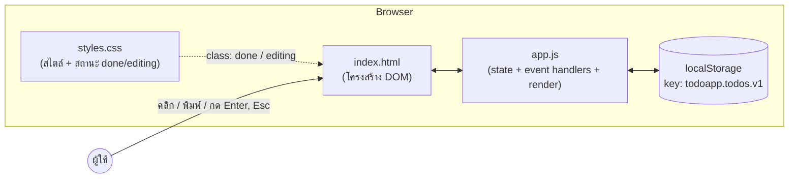

# เอกสารสถาปัตยกรรม (Architecture) — เว็บ Todo List

> เจ้าของไฟล์: architect | อ้างอิงจาก: `docs/01-backlog.md`
> สถานะโจทย์: เว็บแอปฝั่ง client ล้วน ไม่มี backend ไม่มี database ไม่มี filter (out of scope)

---

## 1. Tech Stack และเหตุผล

| ส่วน | เลือกใช้ | เหตุผล |
|---|---|---|
| ภาษา | HTML5 + CSS3 + JavaScript (Vanilla / ES2020+) | โจทย์เป็น client-only ไม่มี backend — ไม่จำเป็นต้องมี framework ใด ๆ เป็นของเรียบง่ายที่สุด รันได้ทันทีโดยเปิดไฟล์ในเบราว์เซอร์ ไม่ต้อง build ไม่ต้องติดตั้งอะไร |
| Framework / Library | ไม่ใช้ (Vanilla JS) | ขอบเขตมีแค่ CRUD ใน list เดียว + localStorage — การใช้ React/Vue จะเพิ่ม build step, node_modules, และความซับซ้อนโดยไม่จำเป็น ขัดหลัก "เลือกของที่เรียบง่ายที่สุด" |
| Storage | `localStorage` (Web API ในตัวเบราว์เซอร์) | ตรงตาม requirement US-004 ข้อมูลคงอยู่หลัง refresh, ซิงก์แบบ synchronous ง่ายต่อการใช้งาน, ไม่ต้องมี server |
| Build tool / Bundler | ไม่ใช้ | ไฟล์ static 3 ไฟล์เท่านั้น ไม่มี dependency ไม่มี build step — ลดจุดที่ผิดพลาดได้ |
| Testing | ทดสอบด้วยเบราว์เซอร์ + DevTools (manual) ตามแผนของ qa | ขอบเขตเล็กเกินกว่าจะติดตั้ง test framework แยก (ให้ qa เป็นผู้กำหนดรายละเอียดต่อ) |
| Hosting / Deploy | Static hosting ใดก็ได้ (GitHub Pages, Netlify, หรือเปิดไฟล์ `index.html` ตรง ๆ) | ไม่มี backend — deploy คือการ copy ไฟล์ static เท่านั้น |

### การตัดสินใจ: ไฟล์เดียว หรือแยกไฟล์?
**เลือกแยกไฟล์ 3 ไฟล์** (`index.html` / `styles.css` / `app.js`) เหตุผล:
- แยกความรับผิดชอบชัดเจน (โครงสร้าง / สไตล์ / ตรรกะ) — ทำให้ dev, qa และ security ตรวจสอบง่าย โดยเฉพาะการตรวจ XSS ที่กระจุกอยู่ใน `app.js` ไฟล์เดียว
- ยังคงเรียบง่ายเท่าเดิม (ไม่มี build step) แต่โค้ดอ่านง่ายกว่าไฟล์เดียวยาว ๆ
- ไม่เลือกไฟล์เดียว เพราะไฟล์เดียวจะยิ่งรกเมื่อมีฟีเจอร์ edit + clearCompleted + counter รวมกัน

---

## 2. ภาพรวมสถาปัตยกรรม

แอปทำงานฝั่ง client ทั้งหมด ไม่มี network call ใด ๆ ยกเว้นการโหลดไฟล์ static ครั้งแรก



**วงจรการทำงานหลัก (unidirectional data flow แบบง่าย):**
1. ผู้ใช้กระทำการ (event) → event handler ใน `app.js`
2. handler แก้ค่า `state.todos` (in-memory array)
3. เรียก `save()` เขียนลง localStorage ทันที
4. เรียก `render()` วาด DOM ใหม่ทั้ง list จาก state เสมอ (single source of truth คือ `state.todos`)

---

## 3. โครงสร้างโฟลเดอร์โปรเจกต์

```
project/
├── index.html          # โครงสร้างหน้าเว็บ (form input, ul list, counter, ปุ่ม clearCompleted)
├── styles.css          # สไตล์ทั้งหมด (รวมสถานะ .done, .editing, .shake)
├── app.js              # ตรรกะทั้งหมด (state, event handling, render, save/load)
└── docs/
    ├── 01-backlog.md   # (pm)
    ├── 02-ux.md        # (ux) — ยังไม่มี
    ├── 03-architecture.md  # ไฟล์นี้ (architect)
    └── ...             # ไฟล์ส่งงานอื่น ๆ ตาม AGENTS.md
```

ไม่มีโฟลเดอร์ `src/`, `node_modules/`, `dist/` — ไม่จำเป็นสำหรับ static 3 ไฟล์

---

## 4. Data Model / Schema

### 4.1 Todo object (ใน memory และใน JSON)

| Field | Type | คำอธิบาย |
|---|---|---|
| `id` | `string` | ตัวระบุไม่ซ้ำ — ใช้ `crypto.randomUUID()` (มีในเบราว์เซอร์สมัยใหม่ทุกตัว) หรือ fallback `Date.now() + random` |
| `text` | `string` | ข้อความ todo (trim แล้ว ไม่เป็นค่าว่าง) |
| `done` | `boolean` | สถานะเสร็จ/ยังไม่เสร็จ (ค่าเริ่มต้น `false` ตาม US-001) |
| `createdAt` | `string` (ISO 8601) | เวลาที่สร้าง `new Date().toISOString()` — ใช้รักษาลำดับรายการตามที่เพิ่ม (US-004 ข้อ 2) |

ตัวอย่าง object:
```json
{ "id": "3f2a...", "text": "ซื้อข้าวเย็น", "done": false, "createdAt": "2026-10-30T08:00:00.000Z" }
```

### 4.2 รูปแบบการเก็บใน localStorage

- **Key:** `todoapp.todos.v1` (มี version suffix เผื่ออนาคตต้องเปลี่ยน schema)
- **Value:** JSON string ของ array เรียงตามลำดับที่ผู้ใช้เพิ่ม (เก่าสุดอยู่บนสุด) เช่น
  ```json
  [{"id":"...","text":"...","done":false,"createdAt":"..."}, ...]
  ```

### 4.3 การรับมือข้อมูลเสียหาย (US-004 ข้อ 4)

ขั้นตอน `load()`:
1. `localStorage.getItem(KEY)` — ถ้าได้ `null` (ครั้งแรก) → คืน `[]` และแสดงสถานะว่าง ไม่ error
2. `JSON.parse(...)` อยู่ใน `try/catch` — ถ้า parse ไม่ได้ (ข้อมูลเสียหาย) → คืน `[]`, แสดงสถานะว่าง, แอปทำงานต่อได้ปกติ (ไม่ crash)
3. ตรวจความถูกต้องเบื้องต้น: ถ้าผลลัพธ์ไม่ใช่ array → คืน `[]`; กรองเฉพาะ item ที่มี `id` (string), `text` (string), `done` (boolean) ครบ — item ที่โครงสร้างเพี้ยนจะถูกข้าม
4. ไม่พยายาม "ซ่อม" ข้อมูลเสียหาย — หลักการคือ fail-safe เป็น list ว่าง เพื่อไม่ให้แอปใช้งานไม่ได้เลย

---

## 5. สถาปัตยกรรมฝั่ง Client

### 5.1 การจัดการ State

- **Single source of truth:** ตัวแปรเดียว `state = { todos: [...] }` ใน `app.js`
- ทุกการเปลี่ยนแปลงต้องผ่านฟังก์ชัน action เท่านั้น (ห้ามแก้ DOM ตรง ๆ นอก `render()`)
- ลำดับการทำงานของทุก action: **แก้ state → `save()` → `render()`** (เรียกรวมว่า `commit()` เพื่อไม่ให้ใครลืม save)

### 5.2 ฟังก์ชันหลัก

| ฟังก์ชัน | หน้าที่ | แมปกับ US |
|---|---|---|
| `addTodo(text)` | ตรวจว่า trim แล้วไม่ว่าง → push object ใหม่ (`done: false`) → commit | US-001 |
| `deleteTodo(id)` | กรองออกจาก array ด้วย `id` → commit | US-002 |
| `toggleTodo(id)` | สลับ `done` ของ item ที่มี `id` → commit | US-003 |
| `editTodo(id, newText)` | ตรวจว่า trim แล้วไม่ว่าง → แทนที่ `text` → commit | US-005 |
| `clearCompleted()` | กรองเหลือเฉพาะ `done === false` → commit | US-006 |
| `render()` | วาด list, counter, สถานะปุ่ม clearCompleted ใหม่ทั้งหมดจาก state | ทุก US |
| `save()` | `localStorage.setItem(KEY, JSON.stringify(state.todos))` ใน `try/catch` (กันกรณี quota เต็ม / storage ถูก block) | US-001, 004 |
| `load()` | อ่าน + parse + validate ตามข้อ 4.3 | US-004 |

### 5.3 Event Handling

| เหตุการณ์ | การจัดการ |
|---|---|
| กดปุ่มเพิ่ม / กด Enter ใน input | `submit` event ของ `<form>` (ใช้ `preventDefault()`) — ครอบคลุมทั้งกดปุ่มและ Enter ในกลไกเดียว |
| คลิก checkbox | **Event delegation** บน `<ul>`: ฟัง `change` แล้วดู `data-id` ของ parent `<li>` → `toggleTodo` |
| คลิกปุ่มลบ | Event delegation บน `<ul>`: ฟัง `click` ปุ่มลบ → `deleteTodo` |
| เข้าโหมดแก้ไข | คลิกปุ่ม edit (หรือ double-click ข้อความ) → เปลี่ยน `<li>` นั้นเป็น `<input>` + สถานะ `editingId` ใน state |
| บันทึกการแก้ไข | กด Enter หรือ blur → `editTodo`; กด **Esc** → ยกเลิกกลับค่าเดิม (US-005 ข้อ 4) |
| คลิกปุ่ม clearCompleted | `clearCompleted()` — ปุ่มจะ disabled เมื่อไม่มีรายการเสร็จ (US-006 ข้อ 4) |
| เปิดหน้าเว็บ | `DOMContentLoaded` → `load()` → `render()` |

**หลักการ:** ใช้ event delegation บน container เดียวสำหรับ list เพื่อไม่ต้องผูก listener ใหม่ทุกครั้งที่ `render()` — ลด bug และ memory leak

### 5.4 การ Render

- `render()` สร้าง element ใหม่ทั้ง list ทุกครั้ง (list ขนาดเล็ก — ความเรียบง่ายชนะ performance)
- **ข้อความผู้ใช้ทุกจุดต้องตั้งผ่าน `textContent` เท่านั้น** (ดูข้อ 6)
- Counter (US-007) คำนวณจาก state ตอน render: จำนวน `done === false` (และ/หรือจำนวนเสร็จ)
- สถานะว่าง (ไม่มีรายการ / ครั้งแรก) แสดงข้อความ "ยังไม่มีรายการ" — ไม่ใช่ error

---

## 6. ข้อควรระวังด้านความปลอดภัย (ฝังในการออกแบบ)

| ความเสี่ยง | การออกแบบรับมือ |
|---|---|
| **XSS จากข้อความผู้ใช้** (เช่น พิมพ์ `` เป็น todo) | **ห้ามใช้ `innerHTML` กับข้อมูลผู้ใช้เด็ดขาด** — สร้าง element ด้วย `document.createElement()` แล้วตั้งข้อความด้วย `textContent` เสมอ ทำให้เบราว์เซอร์ escape ให้โดยอัตโนมัติ ห้ามใช้วิธี "escape เองแล้วใส่ innerHTML" เพราะเปราะบางต่อมนุษย์ผิดพลาด |
| Event injection ผ่าน attribute | ไม่สร้าง HTML string เลยตั้งแต่ต้น — ไม่มีจุดให้ inject attribute เช่น `onerror` |
| `id` ปลอมใน localStorage | `id` ใช้เป็นค่าใน `data-id` attribute เท่านั้น (ตั้งผ่าน `dataset`) ไม่ใช่ส่วนของ HTML string |
| ข้อมูลเสียหายใน localStorage | ตามข้อ 4.3 — validate ก่อนใช้เสมอ ไม่เอา JSON ดิบไปใช้ตรง ๆ |
| localStorage quota / ถูกปิด (เช่น private mode บางเบราว์เซอร์) | `save()` และ `load()` ห่อ `try/catch` — ถ้าบันทึกไม่ได้ แอปยังใช้งานได้ใน session เดียว (ข้อมูลหายเมื่อปิดหน้า) และไม่ crash |
| ไม่มีข้อมูลส่วนบุคคล / ไม่มี network | แอปไม่ส่งข้อมูลออกนอกเครื่อง ไม่มี cookie ไม่มี third-party script — attack surface เล็กมากโดยธรรมชาติ |

> หมายเหตุสำหรับ security: จุดตรวจสำคัญคือ `app.js` — ค้นหาว่าไม่มี `innerHTML` / `insertAdjacentHTML` / `document.write` กับข้อมูลผู้ใช้เลย

---

## 7. ข้อกำหนดที่ไม่ใช่ฟังก์ชัน (Non-functional Requirements)

### ความปลอดภัย
- ตามข้อ 6 — โดยเฉพาะกฎ "textContent เท่านั้น" สำหรับข้อความผู้ใช้
- ไม่มีการเก็บข้อมูลส่วนบุคคล, ไม่มี tracking, ไม่มี external CDN (โหลดไฟล์จากเครื่องเดียวกันทั้งหมด)

### ประสิทธิภาพ
- โหลดครั้งแรก: 3 ไฟล์ static รวมกันไม่กี่ KB — ไม่มี network dependency
- `render()` แบบ rebuild ทั้ง list รองรับได้สบายถึงหลักร้อย–พันรายการ (localStorage จำกัด ~5MB อยู่แล้ว)
- ทุก action เขียน localStorage แบบ synchronous — สำหรับ todo list ถือว่าเร็วพอ ไม่ต้อง debounce

### การ Deploy
- Deploy = copy 3 ไฟล์ static ขึ้น static hosting ใดก็ได้ (GitHub Pages / Netlify / หรือเปิดไฟล์ตรง ๆ ผ่าน `file://`)
- ไม่มี environment variable, ไม่มี migration, ไม่มี build step — rollback คือการใช้ไฟล์เวอร์ชันก่อน
- รองรับเบราว์เซอร์สมัยใหม่ (Chrome, Edge, Firefox, Safari เวอร์ชันล่าสุด) — ใช้ `crypto.randomUUID()` ซึ่งมีทุกเบราว์เซอร์หลักในเวอร์ชันปัจจุบัน

---

## 8. ความเสี่ยงและข้อแลกเปลี่ยน (Trade-offs)

| การตัดสินใจ | ได้ | เสีย / ความเสี่ยง | วิธีรับมือ |
|---|---|---|---|
| Vanilla JS ไม่ใช้ framework | ไม่มี build step, deploy ง่ายสุด, โค้ดน้อย | ถ้าโปรเจกต์โตขึ้น (filter, drag-drop, sync) การจัดการ state ด้วยมือจะเริ่มยาก | โครงสร้าง state → commit() → render() เตรียมไว้ให้ refactor ไปใช้ framework ได้ง่ายถ้าจำเป็นในอนาคต |
| `render()` แบบ rebuild ทั้ง list | โค้ดสั้น ไม่มีจุดบกพร่องแบบ partial update | ถ้า list ใหญ่มากอาจกระตุก; โหมด editing จะถูกรีเซ็ตถ้า render ระหว่างแก้ไข | จำกัดด้วยขนาด localStorage อยู่แล้ว; ระหว่างโหมด editing ให้ render เฉพาะเมื่อ commit เท่านั้น |
| เก็บใน localStorage | ตรง requirement, ทำงาน offline, ไม่ต้องมี server | ข้อมูลผูกกับเครื่อง+เบราว์เซอร์เดียว หายได้ถ้าล้างข้อมูล, quota ~5MB | เป็นข้อจำกัดที่ผู้ใช้ยอมรับแล้วใน backlog (Constraints) — แสดงข้อความแจ้งถ้า save ไม่สำเร็จ |
| ไม่จำกัดจำนวนรายการ | ตรงตาม Confirmed Decisions ข้อ 4 | ถ้าใส่หลักหมื่นรายการ localStorage อาจเต็ม | `save()` มี try/catch แจ้งผู้ใช้แทนการ crash |
| แยก 3 ไฟล์ | อ่านง่าย ตรวจง่าย | ต้องเปิดผ่าน server หรือ hosting จริงจึงจะเห็นการทำงานเต็มรูปแบบในบางกรณี (แต่กรณีนี้ไม่มี fetch/module จึงเปิดผ่าน `file://` ได้) | ใช้ `<script src="app.js" defer>` ปกติ ไม่ใช้ ES modules เพื่อให้เปิดผ่าน `file://` ได้ |

---

## 9. คำถาม / สิ่งที่รอข้อมูลเพิ่ม

1. **ยังไม่พบไฟล์ `docs/02-ux.md`** — สถาปัตยกรรมนี้ออกแบบโดยอิง backlog ล้วน ถ้า UX มีผลต่อสถาปัตยกรรม (เช่น ต้องการ real-time, drag-and-drop, ธีมมืด/สว่างที่ต้อง persist เพิ่ม) ให้แจ้งกลับมาแล้วจะปรับเอกสาร — ณ ตอนนี้ไม่มีอะไรใน backlog ที่บังคับให้เปลี่ยนแบบ static client-only
2. ข้อกำหนด "UI รองรับไทย+อังกฤษแบบ hybrid" เป็นเรื่องการนำเสนอ (hardcode label สองภาษาใน HTML) — ไม่ต้องใช้ i18n framework หรือ persist ภาษาที่เลือก ถ้า ux ต้องการให้ผู้ใช้ "สลับภาษา" แทนการแสดงคู่กัน ต้องแจ้งมาก่อนเขียน spec
